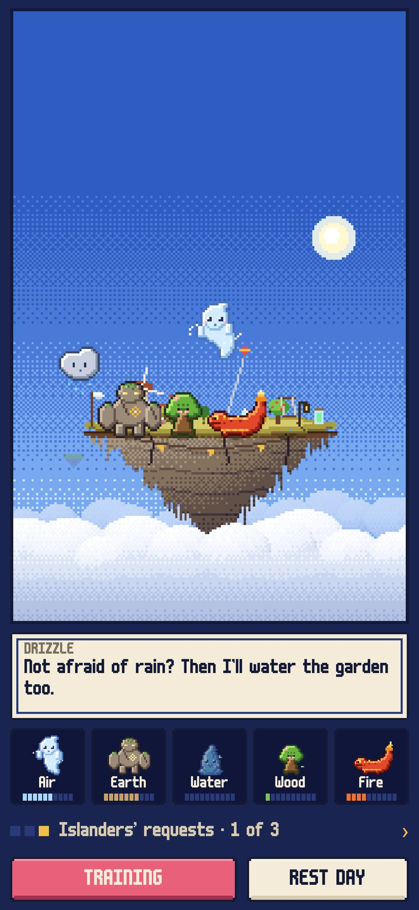
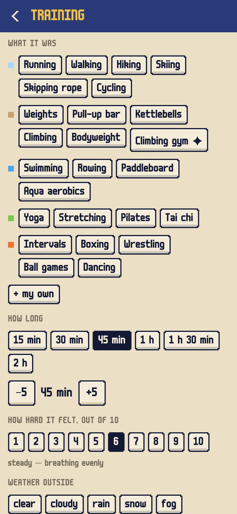
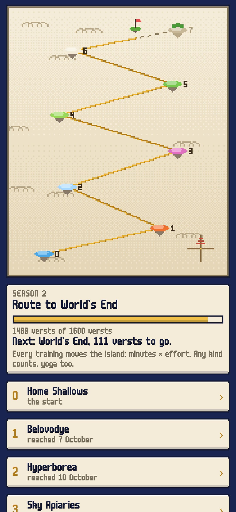
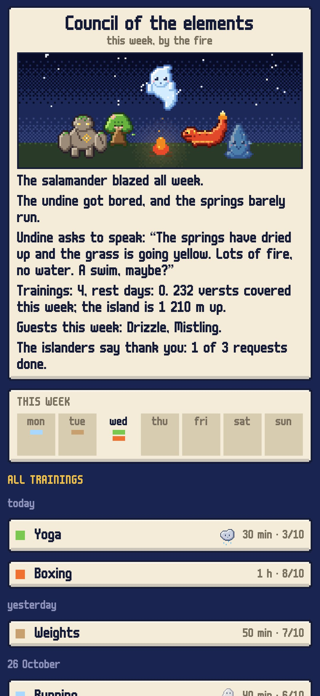
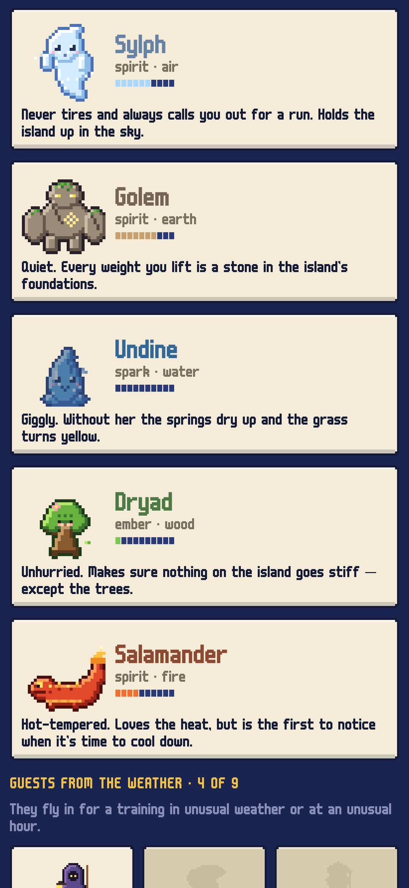

<div align="center">


# Aloft

### A training log where five spirits keep your island in the sky.

*Every kind of training feeds an elemental spirit: running feeds the sylph of air, weights the golem of earth, swimming the undine, stretching the dryad, sparring the salamander of fire. The more evenly you train, the higher your floating island rises and the more grows on it; an imbalance shows as weather on the island, a sudden jump brings a storm. Every training also carries the island on a voyage past legendary islands, islanders ask small favours each week, and rare guests fly in when you train in the rain, the snow or at dawn. Free, no ads, no account.*

[](https://github.com/bigdevwhale/aloft/actions/workflows/android.yml)
[](https://github.com/bigdevwhale/aloft/releases/latest)


[](LICENSE)

**English** · [Русский](README.ru.md) · [Changelog](CHANGELOG.md)

    

</div>

---

## How it works

1. **Five elements.** Every kind of training feeds one spirit:
   - long and steady work (running, walking, skiing, cycling) is **air**, the sylph;
   - heavy work (weights, the bar, climbing) is **earth**, the golem;
   - anything in water is **water**, the undine;
   - stretching, yoga and balance are **wood**, the dryad;
   - bursts and fights (intervals, boxing, ball games, dancing) are **fire**, the salamander.

   24 kinds are built in, and you can add your own and give them to any spirit.
2. **Load, honestly.** A training counts as minutes × how hard it felt, 1 to 10 (session RPE). It feeds its element and fades over about two weeks, and a spirit grows from a spark to an ember, a spirit and a great spirit. The island's height is the average of all five.
3. **Imbalance is weather.** Fire without water dries the grass. Water without earth crumbles the edges. Air without earth throws the island about. Earth without air makes it sink. With no stretching, the stone cracks. Two strong elements together raise a mill, a forge, hot springs, a garden, a grove or a rainbow.
4. **Storms and calm.** When the last week's load jumps far above the last four weeks', a storm gathers and the spirit asks for rest. A rest day brings calm, and the spirits sleep. Ill or injured? Drop anchor: nothing fades until you weigh it.
5. **The voyage.** Every training carries the island along the season's route past Laputa, Buyan, the Glass Mountain and Avalon, or, next season, Belovodye, Hyperborea and World's End. Each stop sends a letter and a keepsake that appears on the island.
6. **Islanders' requests.** The miller, the stonemason, the herbalist, the forester, the smith and the lighthouse keeper ask three small favours a week. The first always comes from the weakest element. A pennant hangs under the island for each one done, and enough thanks bring a birdhouse, a swing, a bell, a weathervane.
7. **Guests from the weather.** With a town set, the island sees the real weather. Train in the rain, the snow, fog, frost or heat, at dawn or after dark, or try something new, and a rare guest flies in: nine to meet.
8. **The council of the elements.** The log ends each week with the spirits round a fire, telling the week in a few plain sentences.

## Privacy

No account, no ads, no analytics. The log stays on the phone. The only network requests are the town search and the weather: the chosen town's coordinates go to Open-Meteo (or MET Norway), nothing else.

## Building

```bash
./gradlew testDebugUnitTest assembleDebug              # app.aloft.dev, next to a real install
./gradlew assembleDebug -Pdemo                         # app.aloft.demo, eight weeks of training and a voyage under way
./gradlew testDebugUnitTest -Prender --tests '*RenderArt*' && python tools/shots.py   # screenshots and sprite sheets
python tools/res.py                                    # the string resources, EN and RU
python tools/icon.py                                   # the launcher icon and the logo, from tools/icon.png
```

Built with Kotlin, Jetpack Compose, Room, DataStore and WorkManager. Every picture is pixel art drawn in code: the five spirits in four stages and four frames, nine guests, the island with its buildings and weather, the sky chart and the campfire. Judge animation speed on a release build; debug builds are much slower.

## License

[MIT](LICENSE). Font: m6x11 by Daniel Linssen, Cyrillic by Natto Games (free with attribution). Weather: [Open-Meteo.com](https://open-meteo.com) and [MET Norway](https://api.met.no) (CC BY 4.0). The load model is a general guide, not medical advice.
