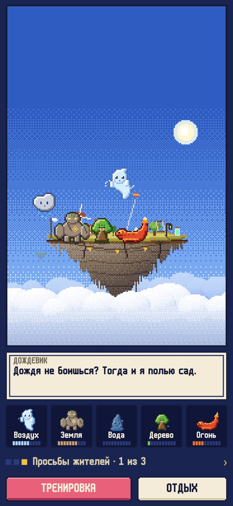
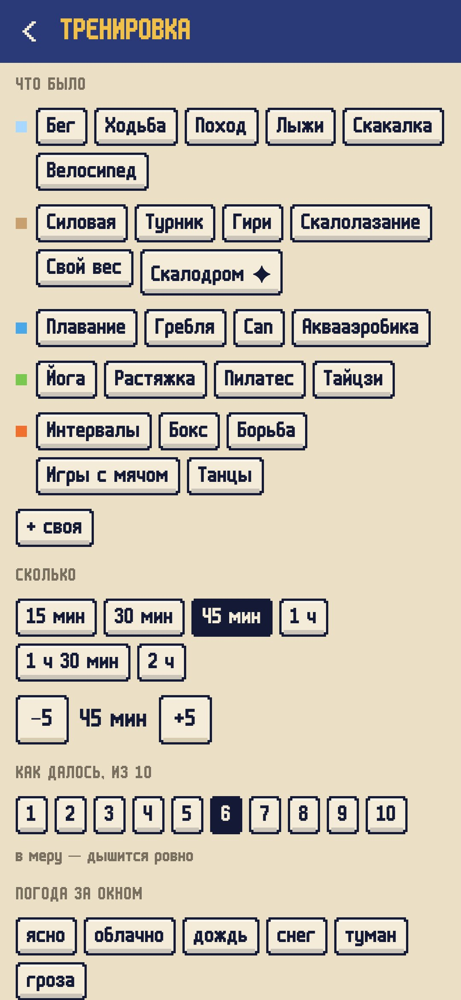
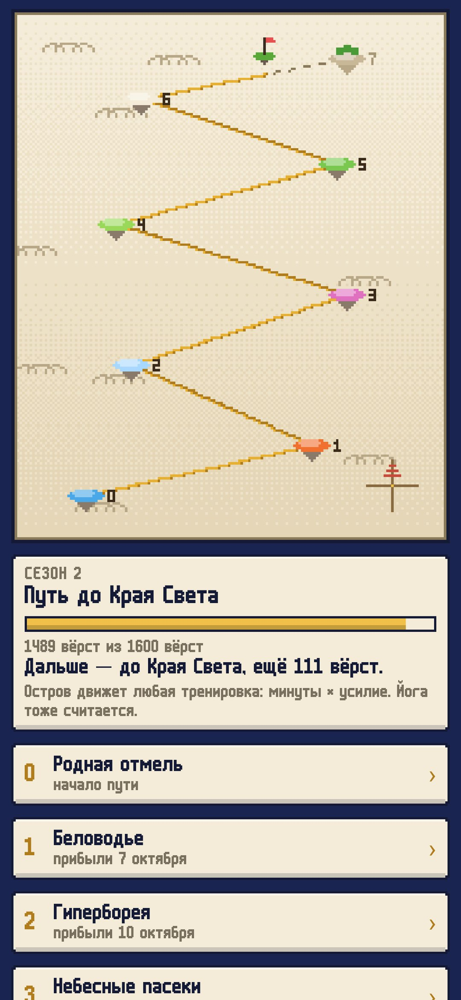
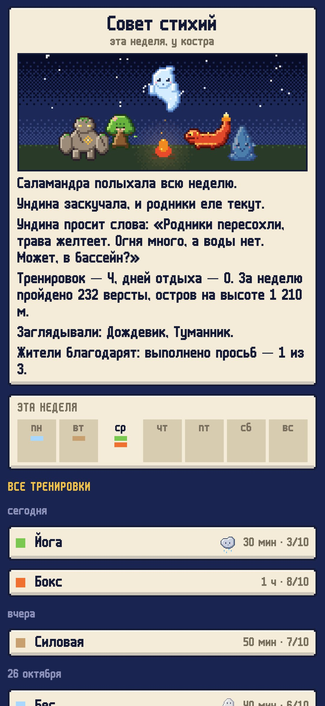
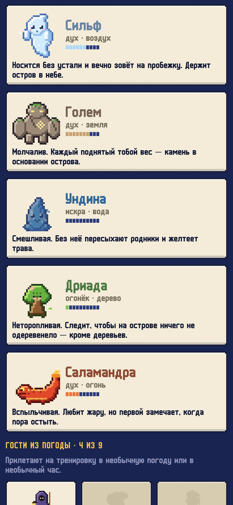

<div align="center">


# Летучий остров

### Дневник тренировок, в котором пять духов стихий держат в небе твой летучий остров.

*Над облаками парит маленький остров. В воздухе его держат пять духов: сильф, голем, ундина, дриада и саламандра. Силы им дают твои тренировки, причём у каждого духа свои: пробежки достаются сильфу, штанга — голему, бассейн — ундине, растяжка — дриаде, бокс — саламандре. Чем разнообразнее занимаешься, тем выше поднимается остров и тем больше на нём построек. Перекос сразу видно: без воды на острове сохнет трава, без силовых осыпаются края, без растяжки камень идёт трещинами. Если резко прибавить нагрузку, над островом соберётся гроза — значит, пора отдохнуть. Заодно тренировки ведут остров в путешествие к Лапуте, Буяну и Авалону. Каждую неделю жители просят о какой-нибудь мелочи, а если выйти на тренировку в дождь, в снег или на рассвете, прилетит редкий гость. Бесплатно, без рекламы и регистрации.*

[](https://github.com/bigdevwhale/aloft/actions/workflows/android.yml)
[](https://github.com/bigdevwhale/aloft/releases/latest)


[](LICENSE)

[English](README.md) · **Русский** · [Изменения](CHANGELOG.md)

    

</div>

---

## Как это устроено

1. **Пять стихий.** Каждый вид тренировки кормит своего духа:
   - долгое и ровное (бег, ходьба, лыжи, велосипед) — **воздух**, сильф;
   - тяжёлое (силовая, турник, скалолазание) — **земля**, голем;
   - всё, что в воде, — **вода**, ундина;
   - растяжка, йога, равновесие — **дерево**, дриада;
   - взрывное и бои (интервалы, бокс, игры с мячом, танцы) — **огонь**, саламандра.

   Встроено 24 вида, свои можно добавить и отдать любому духу.
2. **Честная нагрузка.** Тренировка считается как минуты × усилие от 1 до 10. Она кормит духа своей стихии и выветривается примерно за две недели. Дух растёт от искры до огонька, духа и великого духа. Высота острова — среднее по всем пяти.
3. **Перекос — это погода.** Огонь без воды сушит траву. Вода без земли подмывает края. Воздух без земли раскачивает остров. Земля без воздуха тянет его вниз. Без растяжки камень трескается. Две сильные стихии вместе ставят мельницу, кузню, горячие источники, сад, рощу или радугу.
4. **Гроза и штиль.** Если нагрузка за неделю резко выросла по сравнению с последними четырьмя, собирается гроза, и дух просит отдохнуть. День отдыха — это штиль, духи спят. Болеешь или травма? Брось якорь: пока он не поднят, ничего не выветривается.
5. **Путь.** Каждая тренировка ведёт остров по маршруту сезона: Лапута, Буян, Стеклянная гора, Авалон, а в следующем сезоне — Беловодье, Гиперборея и Край Света. С каждой остановки приходит письмо и подарок, который появляется на острове.
6. **Просьбы жителей.** Мельник, каменотёс, травница, лесничий, кузнец и смотритель маяка просят о трёх мелочах в неделю, первая — всегда от самой слабой стихии. За каждую выполненную под островом вешают флажок, а за накопленные благодарности дарят скворечник, качели, колокол и флюгер.
7. **Гости из погоды.** С городом остров видит настоящую погоду. Тренировка в дождь, снег, туман, мороз или жару, на рассвете или затемно, а то и что-то новое — и прилетает редкий гость. Всего их девять.
8. **Совет стихий.** Неделя в журнале заканчивается у костра: духи пересказывают её в нескольких простых фразах.

## Приватность

Ни аккаунтов, ни рекламы, ни аналитики. Журнал хранится на телефоне. Единственные запросы в сеть — поиск города и погода: координаты выбранного города уходят в Open-Meteo (или MET Norway), больше ничего.

## Сборка

```bash
./gradlew testDebugUnitTest assembleDebug              # app.aloft.dev, рядом с настоящей установкой
./gradlew assembleDebug -Pdemo                         # app.aloft.demo, восемь недель тренировок и путь в разгаре
./gradlew testDebugUnitTest -Prender --tests '*RenderArt*' && python tools/shots.py   # скриншоты и листы спрайтов
python tools/res.py                                    # строки, EN и RU
python tools/icon.py                                   # иконка и логотип из tools/icon.png
```

Kotlin, Jetpack Compose, Room, DataStore и WorkManager. Вся графика — пиксель-арт в коде: пять духов в четырёх стадиях и четырёх кадрах, девять гостей, остров с постройками и погодой, небесная карта и костёр. Плавность анимации проверяй на release-сборке: отладочная заметно медленнее.

## Лицензия

[MIT](LICENSE). Шрифт: m6x11 — Daniel Linssen, кириллица — Natto Games (бесплатно с указанием авторов). Погода: [Open-Meteo.com](https://open-meteo.com) и [MET Norway](https://api.met.no) (CC BY 4.0). Модель нагрузки — общий ориентир, а не медицинский совет.
